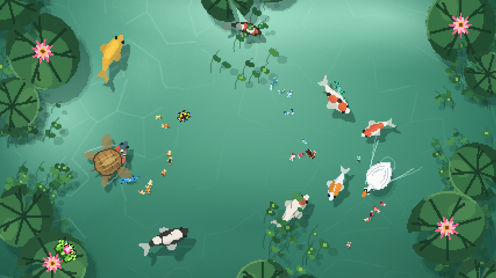

# Koi Wallpaper

An interactive living koi pond desktop wallpaper for macOS 14+ (Sonoma or later), built natively with Swift, AppKit, and CoreGraphics with zero external dependencies or internet access required.



Koi Wallpaper runs quietly on your desktop canvas below your Finder icons, operates with minimal battery impact, and brings a peaceful, responsive pond ecosystem to your Mac.

---

## Key Features

- **8 Authentic Japanese Koi Varieties**: Kohaku, Taisho Sanke, Showa Sanshoku, Yamabuki Ogon, Asagi, Shiro Utsuri, Tancho, and Kikusui featuring realistic 3D Z-depth diving kinematics, anatomical spine curvature, hydrodynamic fin motion, and physical non-penetration guarantees.
- **Living Pond Ecosystem**:
  - Pond visitors: Majestic Swan, Duck, and floating Japanese Temari Ball.
  - Pond fauna: Freshwater Japanese Pond Turtle (*Nihon Ishigame*), perched frogs on static lily pads, lotus-orbiting butterflies, decorative small fish schools, and nocturnal fireflies.
  - Seasonal floating flora: Spring sakura petals, autumn momiji maple leaves, and floating duckweed.
- **Water Surface Optics & Physics**: Multi-scale 3-layer caustics refraction, continuous ambient water flow currents, and Fresnel specular glints across active ripple ridges.
- **7 Atmospheric Time & Weather Themes**:
  - Dawn, Day, Golden Hour, Dusk, Night (bioluminescent palette), Deep Clear, and Rain (overcast light with gentle ripple particles).
  - Automatically transitions with local clock time or synchronizes with macOS system appearance (Light/Dark).
- **macOS Desktop Integration & Energy Efficiency**:
  - **Click-Through by Default**: Mouse clicks pass through cleanly to Finder desktop icons, drag selection, and files without interruption.
  - **Interactive Mode**: Capture clicks on the pond surface to call koi fish or feed them pellets.
  - **Smart Occlusion & Battery Eco-Mode**: Automatically halts rendering and drops CPU usage to ~0.04% when the desktop is hidden behind windows or during display sleep.
  - **Dynamic Static Wallpaper Mode**: Freezes live animation loops for maximum power saving while updating pond scenes periodically every 15 minutes.
  - **Launch at Login**: Native integration via macOS `SMAppService`.
  - **Zen Arc Koi Menu Bar Icon**: Minimalist 18x18 pt template status icon matching both Dark and Light macOS menu bars.

---

## Installation

### Using the DMG Installer

1. Build the disk image installer:
   ```bash
   ./scripts/build_dmg.sh
   ```
2. Open `build/KoiWallpaper-1.0.0.dmg` and drag the **Koi Wallpaper** icon into your **Applications** folder.
3. Or install directly to your Applications folder from the terminal:
   ```bash
   ./scripts/build_dmg.sh --install
   ```

### Running from Source

To compile and launch the release executable from source:

```bash
swift build -c release
./.build/release/KoiWallpaper
```

To run the standalone interactive preview window:

```bash
swift run KoiWallpaperPreview
```

---

## Controls & Shortcuts

When **Interactive Mode** is active:
- **Left Click**: Tap the water surface to summon koi (*Water Call*).
- **Option + Left Click**: Drop food pellets into the pond (*Food Drop*).

Menu Bar shortcuts:
- `p`: Pause or resume pond animation (*Pause / Resume*).
- `i`: Toggle interaction mode (*Click-Through* vs *Interactive*).
- `f`: Enter or exit fullscreen pond mode.
- `q`: Quit the application.

---

## System Requirements

- macOS 14.0 (Sonoma) or later.
- Architecture: Apple Silicon (M1/M2/M3/M4).

---

## Documentation

Architecture decisions, performance profiling, and audit verification records are documented in the [`docs/`](docs/) directory.
