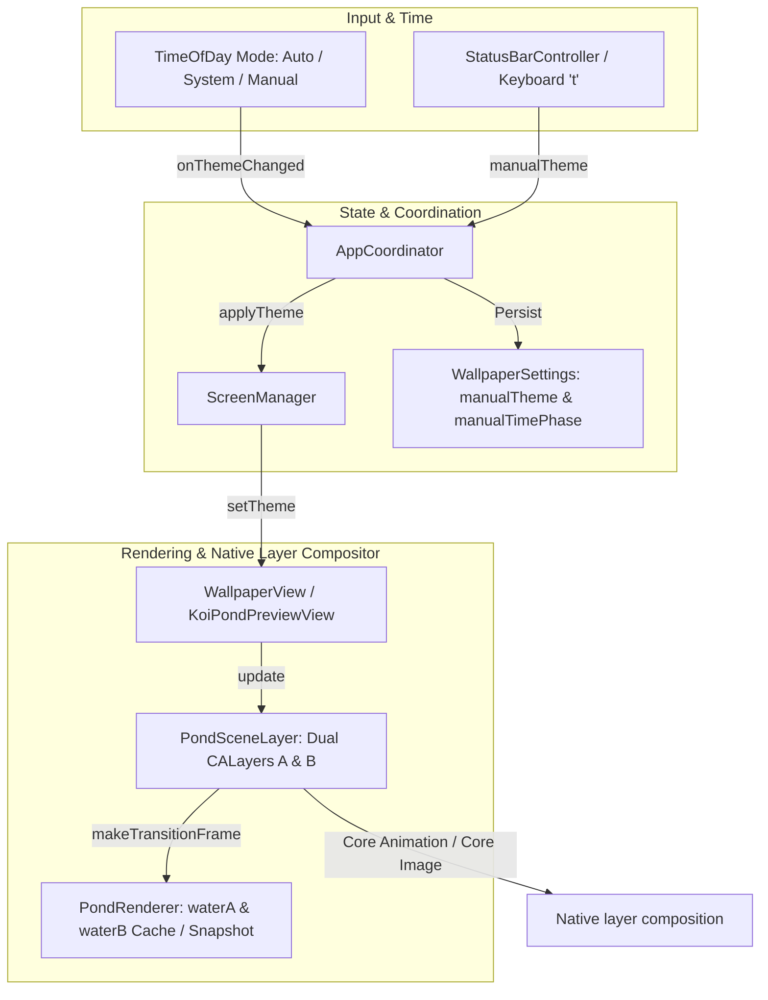
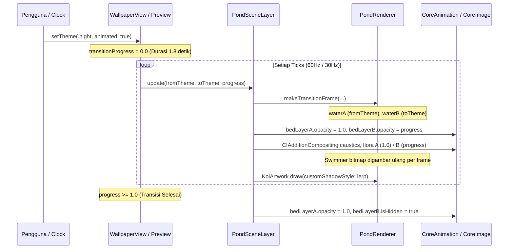

# Audit Teknis: Implementasi M3.6 — Palet dan Transisi Tema

Dokumen ini disusun untuk memfasilitasi audit independen terhadap pekerjaan implementasi **M3.6 — Palet dan transisi tema** pada repositori `koi-wallpaper`.

---

## 1. Ringkasan Eksekutif & Batasan Ruang Lingkup

Tujuan M3.6 adalah menghadirkan identitas visual untuk 7 tema tanpa mengubah fisika simulasi. Transisi dan compositor native dijelaskan berdasarkan implementasi; filter Core Image belum diperiksa secara visual saat runtime.



### Batasan Scope yang Dipatuhi
- **Fisika & Perilaku Koi**: Sistem gerak, kemudi (*steering*), deteksi tabrakan, interaksi klik, makanan, memori, mood, dan RNG ikan koi **tidak diubah**.
- **Preset Rain vs Efek Cuaca**: Preset Rain dibatasi secara ketat pada palet pencahayaan mendung desaturasi dan reflektifitas permukaan; **tidak ada partikel cuaca/tetes hujan** yang ditambahkan (efek partikel masuk cakupan M4).
- **Preset Manual**: Preset `Deep Clear` dan `Rain` diisolasi sebagai preset manual dan **tidak dipaksakan** masuk ke dalam siklus fase waktu Auto.
- **Kemandirian Dependensi**: 100% CoreGraphics prosedural murni; tidak ada dependensi eksternal atau gambar bitmap eksternal baru.

---

## 2. Klasifikasi Bukti Visual: Teramati vs Interpretasi Desain

Sesuai standar kejujuran teknis proyek, berikut klasifikasi asal usul palet visual:

| Tema | Status Bukti | Acuan / Justifikasi Desain | Bukti Implementasi (Viewport 1024×640, Seed 42, t=12s) | Karakteristik Visual Utama |
|---|---|---|---|---|
| **Day** | **Teramati (Observed)** | [fullscreen-visible.png](../analysis/rea/nagomi/screenshots/fullscreen-visible.png) | [theme_m3_6_day.png](../reports/screenshots/theme_m3_6_day.png) | Teal/jade jernih, sorotan bukaan atas terang, berkas diagonal kiri, caustics tajam. |
| **Night** | **Teramati (Observed)** | [night-response.png](../analysis/rea/nagomi/screenshots/night-response.png) | [theme_m3_6_night.png](../reports/screenshots/theme_m3_6_night.png) | Midnight navy dalam, bukaan cyan redup, siluet kontras ikan tetap terbaca jelas. |
| **Rain** | **Teramati (Observed)** | [rain-response.png](../analysis/rea/nagomi/screenshots/rain-response.png) | [theme_m3_6_rain.png](../reports/screenshots/theme_m3_6_rain.png) | Abu-abu teal mendung, caustics difus redup, refleksi permukaan lebih kentara. |
| **Dawn** | **Interpretasi Desain** | Breakdown menit Auto REA & teori fajar | [theme_m3_6_dawn.png](../reports/screenshots/theme_m3_6_dawn.png) | Cahaya emas/peach hangat di atas air yang tetap sejuk. |
| **Golden Hour** | **Interpretasi Desain** | Breakdown menit Auto REA & sore hari | [theme_m3_6_goldenHour.png](../reports/screenshots/theme_m3_6_goldenHour.png) | Berkas sinar amber keemasan pekat di atas air hijau-kebiruan seimbang. |
| **Dusk** | **Interpretasi Desain** | Breakdown menit Auto REA & senja | [theme_m3_6_dusk.png](../reports/screenshots/theme_m3_6_dusk.png) | Refleksi senja coral/lembayung ungu dengan air dalam indigo-teal. |
| **Deep Clear** | **Interpretasi Desain** | Permintaan preset kejernihan air | [theme_m3_6_deepClear.png](../reports/screenshots/theme_m3_6_deepClear.png) | Turquoise kristal kaya dengan transparansi tinggi dan kedalaman ekstra kontras. |

---

## 3. Model Data & Kompatibilitas Pengaturan

1. **Enum [`PondTheme`](../Sources/KoiWallpaperCore/Settings/WallpaperSettings.swift)**:
   - Nilai kasus: `dawn`, `day`, `goldenHour`, `dusk`, `night`, `deepClear`, `rain`.
   - Mengadopsi protokol `String`, `Codable`, `Sendable`, `CaseIterable`.
2. **Ekstensi [`TimeOfDayPhase`](../Sources/KoiWallpaperCore/Time/TimeOfDay.swift)**:
   - Ditambahkan kasus `.goldenHour` untuk melengkapi 5 fase waktu natural REA.
   - Jadwal menit Auto REA:
     - Dawn: 05:30 (330 menit)
     - Day: 07:30 (450 menit)
     - Golden Hour: 16:30 (990 menit)
     - Dusk: 18:00 (1080 menit)
     - Night: 19:30 (1170 menit)
   - Mode System tetap memetakan tampilan terang (`aqua`) ke `.day` dan gelap (`darkAqua`) ke `.night`.
3. **Kompatibilitas Backward [`WallpaperSettings`](../Sources/KoiWallpaperCore/Settings/WallpaperSettings.swift)**:
   - Dekoding kustom: jika payload JSON versi lama tidak memiliki atribut `manualTheme`, parser secara otomatis mengisi nilainya dari `manualTimePhase`.
   - Sinkronisasi dua arah: manipulasi pada `manualTheme` otomatis menyelaraskan `manualTimePhase` (dan sebaliknya) sehingga modul pengujian lama tidak rusak.
4. **Perilaku Reset Pengaturan ([`AppCoordinator.statusBarDidResetSettings`](../Sources/KoiWallpaperCore/App/AppCoordinator.swift))**:
   - Setelah reset ke default, tema aktif yang dikirim ke `ScreenManager` dan ditampilkan pada label menu dihitung dari mode hasil reset (`TimeOfDayMode.auto` yang mengevaluasi jam lokal sistem), bukan memaksakan `defaults.manualTheme`.

---

## 4. Struktur Palet Visual Terstruktur

Untuk mencegah efek air berlumpur (*muddy pond*), sistem menghindari penggunaan filter tint global datar:

1. **Gradien Kedalaman Air 5-Stop ([`PondArtwork.drawWater`](../Sources/KoiWallpaperCore/Rendering/PondArtwork.swift))**:
   - Lapisan dasar, body dalam, mid-water, pengangkatan permukaan, dan bukaan sorotan atas.
   - Dilengkapi `oliveColor` untuk area terlindung di bawah vegetasi tepi dan `lightColor` untuk bukaan atas.
2. **Jaringan Caustics Voronoi Ganda ([`PondWaterSurface.drawVoronoi`](../Sources/KoiWallpaperCore/Rendering/PondWaterSurface.swift))**:
   - 2 lapisan jaring Voronoi independen dengan pembagian eksposur pencahayaan (outer, inner, faint) yang disesuaikan per tema.
3. **Sistem Bayangan Terproyeksi ([`PondLighting.ShadowStyle`](../Sources/KoiWallpaperCore/Rendering/PondLighting.swift))**:
   - Struktur warna RGB, core umbra alpha, stepped penumbra alpha (~14% perluasan siluet), dan small fish alpha.
   - Fungsi `ShadowStyle.lerp` untuk interpolasi kontinu bayangan ikan selama transisi aktif.
4. **Rim Lighting Vegetasi ([`PondFloraArtwork`](../Sources/KoiWallpaperCore/Rendering/PondFloraArtwork.swift))**:
   - Tepi daun teratai dan rona bunga teratai merespons temperatur warna masing-masing tema.

---

## 5. Arsitektur Transisi, Retargeting, dan Alokasi Komposit



### Karakteristik Performa & Alokasi Nyata
1. **Cache Latar Belakang (Air, Caustics, Flora) & Compositing Bebas Bocor**:
   - Tekstur dasar air, 2 jaringan Voronoi caustics, dan 6 rumpun flora berstatus statis per tema dan di-cache dalam `PondWaterSurface` dan `PondRenderer`.
   - **Compositing Source-Over**: Untuk mencegah latar belakang jendela gelap/hitam bocor di tengah transisi ($p=0.5$ menghasilkan $\alpha = 1 - p + p^2 = 0.75$ jika kedua layer semi-transparan), compositing diatur secara presisi:
     - Lapisan dasar air (`bedLayerA` / `bedA`) dan teratai (`floraLayersA` / `floraA`) dipertahankan pada opasitas penuh `1.0`.
     - Lapisan target (`bedLayerB` / `bedB` dan `floraLayersB` / `floraTarget`) dinaikkan opasitasnya secara kontinu sebesar `progress` ($0.0 \to 1.0$).
     - Berdasarkan aturan compositing source-over standard:
       $$C_{\text{out}} = p \cdot C_B + (1 - p) \cdot C_A, \quad \alpha_{\text{out}} = p + (1 - p) \cdot 1.0 = 1.0$$
       Total alpha konstan 100% solid sepanjang transisi; tubuh teratai tidak menjadi tembus pandang (*no ghosting*), dan air tidak pernah meredup ke warna jendela.
     - **Compositing Caustics Premultiplied RGBA Linear**:
       - Caustics merupakan sorotan cahaya transparan. Compositing source-over standar dengan opasitas $(1-p)$ dan $p$ menghasilkan alpha $\alpha = p \alpha_B + (1-p) \alpha_A - p(1-p)\alpha_A \alpha_B$, di mana suku $- p(1-p)\alpha_A \alpha_B$ meredam sorotan yang saling bertumpukan di titik tengah transisi ($p = 0.5$).
       - Formula tujuan compositing RGBA premultiplied adalah $C'_{\text{out}} = (1-p) C'_A + p C'_B$ dan $\alpha_{\text{out}} = (1-p) \alpha_A + p \alpha_B$:
         - **Jalur native (`PondSceneLayer`)**: Tiap pasangan berada dalam pair layer di dalam `causticContainers[i]`. Layer B memakai `CIFilter(name: "CIAdditionCompositing")`; host `WallpaperView` dan `KoiPondPreviewView` mengaktifkan `layerUsesCoreImageFilters`. Source dan target memakai opasitas $1-p$ dan $p$. Group pasangan dikompositkan source-over dengan scene di luarnya. Runtime filter belum diperiksa secara visual, jadi kesetaraan visual jalur native belum terverifikasi.
         - **Jalur offscreen (`PondRenderer`)**: Setiap pasangan memakai `context.beginTransparencyLayer`, source alpha $1-p$, dan target alpha $p$ dengan `CGBlendMode.plusLighter` sebelum `endTransparencyLayer()`.
         - **Jalur snapshot retarget (`PondWaterSurface.snapshotBlend`)**: Source digambar pada alpha $1-p$, target dengan `CGBlendMode.plusLighter` pada alpha $p$ ke bitmap snapshot RGBA premultiplied.
       - Ketiga implementasi menggunakan bobot yang sama. Screenshot statis tema tidak memverifikasi filter native saat transisi.
2. **Swimmer Bitmap (Ikan & Makanan)**:
   - Lapisan ikan (koi berartikulasi, ikan kecil dekoratif, pelet makanan) tetap digambar ulang setiap frame pada logical grid rendah (~270 baris) oleh `PondRenderer` untuk mengikuti gerak dinamis fisika dan kibasan sirip.
3. **Mekanisme Retargeting Dinamis & Batas Memori Snapshot**:
   - **Pembalikan Arah (Reversing)**: Jika transisi A $\to$ B sedang berjalan dan pengguna memilih kembali A (tanpa snapshot sebelumnya), target ditukar dan progres dibalik (`progress = 1.0 - progress`) secara mulus tanpa alokasi baru.
   - **Retarget ke Tema Ketiga (A $\to$ B $\to$ C) & Retarget Berulang**:
     - Snapshot menyiapkan kandidat bed, 2 jaringan caustics, 6 rumpun flora, shadow, tint, dan glimmer secara lokal. State kandidat baru dipasang setelah semua aset berhasil; kegagalan mempertahankan permukaan, cache flora, nilai lighting, flag `isSnapshotSource`, dan sumber snapshot aktif.
     - **Batas Ukuran & Resolusi Geometri**: `meshRasterScale` dihitung berdasarkan ukuran mesh yang benar-benar dirasterisasi (termasuk overscan tepi $W + 2 \times overscan, H + 2 \times overscan$), bukan hanya ukuran viewport:
       - Tekstur dasar air: dibatasi $\le 1536$ px dan $\le 2.250.000$ piksel ($\approx 5,9$ MB RGBA pada viewport 1024×640 @1.5x; batas atas teoritis $\le 9,0$ MB).
       - Jaringan caustics (2 layer): dibatasi $\le 1536$ px per mesh dan $\le 2.250.000$ piksel ($\approx 12,3$ MB RGBA total pada 1024×640 @1.4x; batas atas teoritis $\le 18,0$ MB).
       - Rumpun flora (6 cluster): dibatasi geometri lokal rumpun ($\approx 1,0$ MB RGBA pada 1024×640; batas atas teoritis $\le 3,5$ MB).
       - **Total Memori Snapshot**: Tipikal $\approx 19,2$–$25$ MB RGBA (tergantung resolusi layar desktop/preview), dengan batas atas teoritis mutlak $\le 30,5$ MB RGBA.
     - **Kesiapan Snapshot & Fallback Aman**: `snapshotBlend` dan `snapshotTransition` mengembalikan status `Bool`. `isSnapshotSource = true` hanya diaktifkan jika seluruh kandidat (bed, tepat 2 jaringan caustics, flora, serta nilai lighting) berhasil disiapkan secara lengkap.
       - **Validasi Kelengkapan Caustics**: Source dan target wajib memiliki tepat 2 jaringan caustics (`networks.count == 2`) dan bed (`bed != nil`). `snapshotBlend` menolak pembuatan tekstur jika jaringan kurang dari dua (tidak lagi memakai `min(countA, countB)` yang mentolerir pasangan tidak lengkap). Pada `PondWaterSurface.prepare`, kegagalan alokasi sebagian langsung me-reset state (`bed = nil`, `networks = []`, `keyTheme = nil`) sehingga tidak menyisakan aset parsial.
       - **Validasi Kandidat Renderer**: `PondRenderer.snapshotTransition` memvalidasi kelengkapan kandidat sebelum commit. Untuk source snapshot campuran (`isSnapshotSource == true`), validasi memeriksa ketersediaan bed dan 2 jaringan caustics (`hasCompleteAssets`) tanpa mensyaratkan `keyTheme` sama dengan tema tertentu.
       - **Kasus Pra-Render (`totalRenderedFrames == 0`)**: Sebelum frame pertama dirender, belum ada tampilan campuran yang perlu dipertahankan. Pemanggilan `setTheme` langsung mengarahkan `targetTheme = newTheme` dengan `transitionProgress = 0.0` tanpa melakukan snapshot ataupun mengantre.
       - **Kasus Transisi Terlihat Sedang Berjalan (`totalRenderedFrames > 0`)**: Jika snapshot gagal, A $\to$ B dan sumber visual aktif dipertahankan; C menjadi `pendingTheme` dan dimulai setelah transisi selesai. Permintaan baru memperbarui antrean, dan memilih kembali B membatalkannya. Memilih sumber A membatalkan antrean dan membalik progress jika sumber adalah tema tunggal. Bila renderer memakai snapshot campuran sebagai sumber, arah tidak dibalik; permintaan A tetap diantrekan setelah target saat ini selesai. Seam `simulateSnapshotFailure` tidak tersedia sebagai API publik produksi.
   - **Penerapan tema aplikasi**: `AppCoordinator` hanya menerapkan wallpaper/menu melalui `onThemeChanged`. `onPhaseChanged` tidak diarahkan ke handler tema; karena fase diperbarui lebih dahulu daripada tema, callback fase tidak dapat menerapkan tema antara. Pemilihan tema manual dan reset mengevaluasi tema final secara atomik.
4. **Stasis Jeda (Pause)**:
   - Pada desktop (`WallpaperView`), timer dibekukan via `isPaused`.
   - Pada preview (`KoiPondPreviewView`), `transitionProgress` dan simulasi dibekukan saat `simulation.isPaused == true`, dan `lastFrameTime` disinkronkan ke waktu nyata saat dilanjutkan sehingga tidak ada lompatan mengejar waktu jeda (*zero catch-up jump*).
5. **Reset Pengaturan**: `batchUpdate` menghitung hasil mode/preset reset sekali. Bila tema berubah, `onThemeChanged` mengirim hasil akhir ke `ScreenManager` dan menu; bila tema sama, menu disegarkan untuk mode/preset baru tanpa menerapkan ulang tema.

---

## 6. Laporan Insiden & Perbaikan: Masalah Layar Gelap

### Gejala
Tampilan `KoiPondPreview` sempat tampak gelap/hitam dengan hanya ikan dan riak permukaan yang terlihat (berdasarkan tangkapan layar pengguna pada clipboard lokal).

### Akar Masalah (Root Cause)
Di [`PondSceneLayer.swift`](../Sources/KoiWallpaperCore/Rendering/PondSceneLayer.swift), perhitungan opasitas sebelumnya ditulis:
```swift
bedLayerA.opacity = Float(1.0 - frame.transitionProgress)
```
Saat kondisi stabil (tidak sedang transisi), `transitionProgress` bernilai `1.0`. Akibatnya:
$$\text{opacity} = 1.0 - 1.0 = 0.0$$
Layer dasar (`bedLayerA`), caustics (`causticLayersA`), dan teratai (`floraLayersA`) semuanya diset ke opasitas `0.0` (transparan total). Karena layer cadangan (`bedLayerB`) juga disembunyikan (`isHidden = true`), seluruh latar belakang kolam menjadi tembus pandang menyingkap latar jendela macOS yang gelap.

### Evolusi Perbaikan: Solusi Historis Antara vs Solusi Akhir

#### 1. Solusi Antara (Historis — Telah Diganti)
Perbaikan awal memisahkan kondisi transisi aktif dan stabil:
```swift
// Solusi historis awal (telah digantikan karena masih mengalami alpha dip 0.75):
let isTransitioning = frame.isTransitioning
let alphaA: Float = isTransitioning ? Float(1.0 - frame.transitionProgress) : 1.0
let alphaB: Float = isTransitioning ? Float(frame.transitionProgress) : 0.0

bedLayerA.opacity = alphaA
if isTransitioning {
    bedLayerB.isHidden = false
    bedLayerB.opacity = alphaB
} else {
    bedLayerB.isHidden = true
}
```
*Evaluasi*: Solusi ini berhasil mengatasi layar hitam pada kondisi stabil ($p=1.0$), namun menimbulkan masalah baru: pada titik tengah transisi ($p=0.5$), source-over compositing menghasilkan total alpha $\alpha = 1 - p + p^2 = 0.75$. Sebanyak 25% latar belakang jendela gelap tembus pandang, dan daun teratai menjadi semi-transparan (*ghosting*).

#### 2. Solusi Akhir yang Diterapkan & Aktif
Untuk meniadakan kebocoran latar dan menjaga opasitas 100% solid, arsitektur compositing dimutakhirkan:
1. **Dasar Air & Teratai Opaque**:
   - `bedLayerA.opacity = 1.0` konstan (lapisan dasar tetap solid).
   - `bedLayerB.opacity = progress` ($0.0 \to 1.0$).
   - `floraLayersA.opacity = 1.0` konstan; `floraLayersB.opacity = progress`.
   - Source-over menghasilkan:
     $$C_{\text{out}} = p \cdot C_B + (1 - p) \cdot C_A, \quad \alpha_{\text{out}} = p + (1 - p) \cdot 1.0 = 1.0$$
     Total alpha selalu 1.0; tidak ada kebocoran latar dan tidak ada *ghosting* teratai.
2. **Caustics Transparan (Premultiplied RGBA)**:
   - Jalur native memakai `CIAdditionCompositing` dalam pair layer/container tersendiri; offscreen dan snapshot memakai additive compositing `CGBlendMode.plusLighter`. Formula bobot yang diterapkan:
     $$C'_{\text{out}} = (1 - p) C'_A + p C'_B, \quad \alpha_{\text{out}} = (1 - p) \alpha_A + p \alpha_B$$
     Runtime filter native belum diperiksa secara visual; hasil caustics native saat transisi belum dapat diklaim.
3. Membersihkan dan menyembunyikan [`tintLayer`](../Sources/KoiWallpaperCore/Rendering/PondSceneLayer.swift) saat tema tidak memerlukan tint atmosfer (`backgroundColor = nil`).

---

## 7. Manifes Berkas

| Berkas | Peran Utama |
|---|---|
| [`WallpaperSettings.swift`](../Sources/KoiWallpaperCore/Settings/WallpaperSettings.swift) | Definisi `PondTheme`, properti `manualTheme`, deserialisasi kompatibel lama. |
| [`TimeOfDay.swift`](../Sources/KoiWallpaperCore/Time/TimeOfDay.swift) | Integrasi `.goldenHour`, jadwal 5 fase Auto REA, penyelarasan tema, penanganan aman `NSApplication.shared`. |
| [`PondLighting.swift`](../Sources/KoiWallpaperCore/Rendering/PondLighting.swift) | Publikasi `PondLighting`, struktur `ShadowStyle`, fungsi `lerp`, nilai 7 tema. |
| [`PondArtwork.swift`](../Sources/KoiWallpaperCore/Rendering/PondArtwork.swift) | Gradien kedalaman air 5-stop dan palet atmosfer 7 tema. |
| [`PondWaterSurface.swift`](../Sources/KoiWallpaperCore/Rendering/PondWaterSurface.swift) | Pewarnaan Voronoi caustics untuk 7 tema, metode `snapshotBlend` untuk retargeting mulus. |
| [`PondFloraArtwork.swift`](../Sources/KoiWallpaperCore/Rendering/PondFloraArtwork.swift) | Rim highlight teratai dan penyesuaian rona kelopak bunga per tema. |
| [`DecorativeFishArtwork.swift`](../Sources/KoiWallpaperCore/Rendering/DecorativeFishArtwork.swift) | Integrasi parameter `theme` dan `customShadowStyle`. |
| [`KoiArtwork.swift`](../Sources/KoiWallpaperCore/Rendering/KoiArtwork.swift) | Integrasi parameter `theme` dan `customShadowStyle`. |
| [`PondRenderer.swift`](../Sources/KoiWallpaperCore/Rendering/PondRenderer.swift) | Cache ganda `waterA`/`waterB`, `snapshotTransition`, `clearSnapshotSource`, swimmer rasterizer, offscreen render. |
| [`PondSceneLayer.swift`](../Sources/KoiWallpaperCore/Rendering/PondSceneLayer.swift) | Layer tema ganda, filter `CIAdditionCompositing` untuk pasangan caustics, dan crossfade opasitas. |
| [`WallpaperView.swift`](../Sources/KoiWallpaperCore/Desktop/WallpaperView.swift) | Transisi tema desktop 1,8 detik, retargeting snapshot interupsi, stasis pause. |
| [`KoiPondPreviewView.swift`](../Sources/KoiWallpaperPreview/KoiPondPreviewView.swift) | Transisi preview, retargeting snapshot, pembekuan jeda tanpa catch-up jump, rotasi tema via tombol `'t'`. |
| [`ScreenManager.swift`](../Sources/KoiWallpaperCore/Desktop/ScreenManager.swift) | Propagasi tema ke seluruh monitor desktop aktif. |
| [`StatusBarController.swift`](../Sources/KoiWallpaperCore/App/StatusBarController.swift) | Submenu 7 tema dengan action handler dan sinkronisasi centang status. |
| [`AppCoordinator.swift`](../Sources/KoiWallpaperCore/App/AppCoordinator.swift) | Orkestrasi event tema, penyelarasan reset settings ke mode Auto aktual (bukan memaksakan manualTheme). |
| [`IMPLEMENTATION_PLAN.md`](IMPLEMENTATION_PLAN.md) | Pembaruan status pencapaian M3.6. |
| [`2026-10-21-theme-palettes-and-transitions.md`](decisions/2026-10-21-theme-palettes-and-transitions.md) | Catatan keputusan arsitektur, pemisahan bukti visual, dan analisis retargeting. |

---

## 8. Panduan Verifikasi untuk Auditor

### Status Eksekusi Suite Pengujian
> [!IMPORTANT]
> **Pernyataan Cakupan**: `KoiWallpaperVerify` dan `KoiWallpaperSimTest` tidak dijalankan sesuai batasan tugas. `swift build` memeriksa kompilasi saja. Filter `CIAdditionCompositing` dan hasil visualnya saat runtime macOS belum diperiksa; screenshot palet statis bukan verifikasi transisi caustics native.

Klaim untuk perubahan M3.6 pada revisi ini dibatasi pada kode yang diimplementasikan dan hasil kompilasi. Transaksi snapshot, antrean fallback, pembalikan arah, serta urutan callback tema tidak diklaim sebagai hasil verifikasi runtime.

### Cakupan Pengujian yang Tersedia dalam Repositori
Auditor dapat menjalankan suite pengujian dengan perintah berikut:

1. **Kompilasi Bersih**:
   ```bash
   swift build
   ```
   *Hasil revisi ini*: `swift build` selesai dengan exit code 0. Build memeriksa kompilasi dan tidak memverifikasi perilaku filter saat runtime.

2. **Suite Verifikasi Integrasi**:
   ```bash
   swift run KoiWallpaperVerify
   ```
   *Catatan batas assertion*:
   - `T6.1`: Memverifikasi roundtrip serialisasi `WallpaperSettings` di memori (tidak memeriksa migrasi backward payload JSON lama tanpa `manualTheme`).
   - `T6.2`: Memverifikasi pembagian jam diskrit mode Auto (06:30 dawn, 12:30 day, 18:30 dusk, 22:30/03:30 night).
   - `T6.3`: Memverifikasi invarian array entitas koi tidak dibuat ulang saat pergantian fase.
   - `T7.11`: Memverifikasi integer pixel grid pada layer swimmer dan hit-testing HUD.
   *(Uji otomatis ini tidak mencakup retargeting mid-flight A $\to$ B $\to$ C atau stasis jeda preview)*.

3. **Suite Verifikasi Fisika Simulasi Koi**:
   ```bash
   swift run KoiWallpaperSimTest
   ```
   *Cakupan*:
   - 19 skenario invarian gerak, kecepatan, deteksi tabrakan kapsul artikulasi, dan kemudi koi untuk memastikan tidak ada degradasi perilaku.
