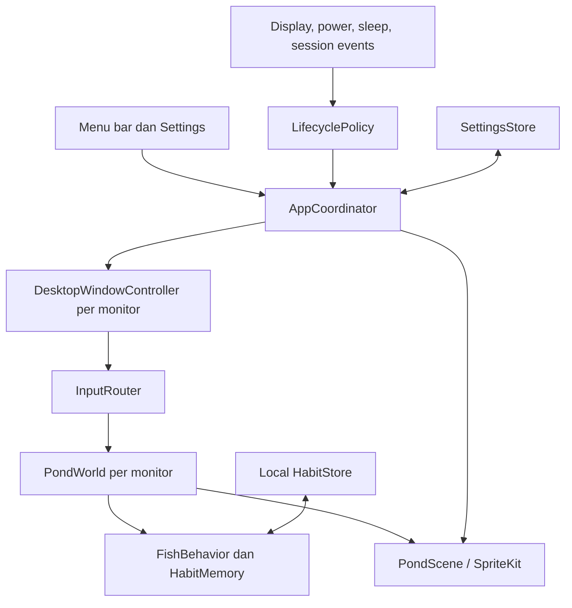

# Analisis referensi Nagomi

Tanggal observasi: 19 Oktober 2026.

REA yang dimaksud pengguna adalah **[Reverse Engineer Anything](https://github.com/morluto/rea/blob/main/docs/cli.md)**. Analisis telah dilengkapi dengan REA CLI 6.7.0: skenario browser, analisis statis dua bundle, proyeksi ringkasan, dan trace semantik. Temuan, Evidence ID, screenshot, serta keterbatasannya dicatat dalam [laporan hasil REA](REA_FINDINGS.md).

## 1. Lingkup dan kekuatan bukti

Proyek masih kosong saat analisis dimulai. Belum ada stack atau implementasi yang perlu dipertahankan.

Yang dibaca: HTML halaman utama dan FAQ yang tertanam dalam payload halaman, halaman dukungan, kebijakan privasi, serta JavaScript demo. REA kemudian menjalankan demo pada Chrome headless, merekam interaksi dan screenshot, lalu menganalisis dua bundle yang diambil dari URL skrip yang tercatat. Bukti analisis disimpan di `analysis/rea/nagomi/`; skrip referensi tidak dijadikan kode atau aset aplikasi proyek.

Interaksi browser telah dijalankan. Aplikasi macOS belum diinstal atau diukur. Karena itu:

- **Dijelaskan produk**: perilaku yang disebutkan oleh situs; belum diverifikasi pada aplikasi.
- **Terlihat di sumber web**: elemen atau pengendali yang ada dalam HTML/JavaScript publik; belum dibuktikan melalui klik langsung.
- **Diamati melalui REA**: aksi, tampilan, DOM, atau keadaan menu yang terekam dalam skenario browser tertentu. Keberhasilan klik tidak membuktikan seluruh efek internalnya.
- **Usulan proyek**: rancangan implementasi kita; bukan penjelasan tentang kode internal Nagomi.

## 2. Produk yang hendak dibangun

Tujuan proyek: kolam koi yang terasa hidup, bisa diajak berinteraksi, dan menjadi bagian desktop tanpa mengganggu pekerjaan. Hasil yang diusulkan berupa aplikasi macOS. Situs Nagomi berfungsi sebagai halaman pemasaran dan demo browser; teknologi situs tidak membuktikan teknologi aplikasi desktop.

### Peta fitur dari referensi

| Fitur | Bukti publik | Prioritas proyek |
| --- | --- | --- |
| Kolam koi pixel art | Gambar kolam dan elemen canvas | P0 |
| Klik memanggil ikan | Dijelaskan halaman utama; pengendali pointer ada di demo | P0 |
| Option + klik memberi makan | Dijelaskan halaman utama; opsi input ada di demo | P0 |
| Suasana menurut jam | Lima fase dijelaskan; pilihan otomatis ada di sumber demo | P0 |
| Menu bar | Dijelaskan produk dan disimulasikan demo web | P0 |
| Pause saat tertutup/baterai | Dijelaskan halaman fitur dan dukungan | P0 |
| Beberapa monitor | Dijelaskan halaman fitur | P1 |
| Karakter ikan | Kesukaan dan sapaan harian dijelaskan di halaman utama | P1 |
| Ingatan waktu/tempat makan | FAQ menyebut memori sederhana lokal dengan pelupaan | P1 |
| Mood | Pilihan Playful/Calm terlihat di sumber demo | P1 |
| Hujan | Ada pada petunjuk dan pengendali demo | P1 |
| Pengunjung | Bola dan angsa ada dalam menu demo | P2 |
| Mode screensaver | Dijelaskan fitur dan dukungan; demo memakai fullscreen browser | P2 |
| Pembaruan aplikasi | Dijelaskan halaman dukungan | P3 |

Pembaruan bukti: klik air, tombol pemberian makan, pemanggilan angsa, malam, hujan, pilihan tema, mood Calm, keadaan pause/input, dan fullscreen telah dijalankan melalui REA. Menu juga memperlihatkan dua tema tambahan, Deep Clear dan Rain. Shortcut Option + klik asli, kebiasaan beberapa hari, serta integrasi macOS masih belum diamati. Rinciannya ada di [laporan REA](REA_FINDINGS.md).

Sumber tabel: [halaman utama dan FAQ Nagomi](https://nagomi.m4yank.com/), [dukungan Nagomi](https://nagomi.m4yank.com/support), dan [skrip antarmuka demo publik saat observasi](https://nagomi.m4yank.com/_next/static/immutable/chunks/1-g8shc-u1egd.js). Nama chunk dapat berubah saat situs diperbarui.

### Temuan yang memengaruhi rancangan

**Rutinitas ikan tidak memerlukan model AI.** FAQ menjelaskan ingatan lokasi dan waktu pemberian makan yang perlahan memudar. Inspeksi bundle yang diinventarisasi REA memperlihatkan grid lokasi 12 × 8, 48 slot waktu, serialisasi JSON, dan peluruhan eksponensial. Persistensi aplikasi macOS serta kesamaan algoritmanya dengan demo belum dibuktikan. [FAQ](https://nagomi.m4yank.com/#faq), [temuan statis dan batas buktinya](REA_FINDINGS.md)

**Mode screensaver perlu didefinisikan jelas.** Dukungan Nagomi menyatakan mode tersebut tidak mengunci komputer dan dapat berbenturan dengan screen saver atau display sleep sistem. Usulan untuk proyek adalah mode tampilan penuh yang dapat dihentikan melalui input. Integrasi screen saver sistem menjadi pekerjaan terpisah jika nanti dibutuhkan. [Dukungan](https://nagomi.m4yank.com/support)

**Simulasi dapat berjalan lokal.** Kebijakan privasi menyatakan aplikasi referensi memakai jaringan untuk lisensi dan pembaruan. Untuk proyek ini, simulasi, artwork, pengaturan, dan memori ikan diusulkan tersedia lokal sejak awal. Kebutuhan lisensi serta distribusi belum diputuskan. [Privasi](https://nagomi.m4yank.com/privacy)

## 3. Analisis visual

Observasi berikut berasal dari frame awal yang ditampilkan situs, bukan seluruh tema atau animasinya. [Frame kolam](https://nagomi.m4yank.com/nagomi/first-frame-sunny.webp)

- Sudut pandang dari atas; air hijau kebiruan dengan variasi kedalaman dan cahaya.
- Teratai dan vegetasi banyak berada di tepi, menyisakan ruang berenang di tengah.
- Koi putih, merah, dan jingga menjadi objek utama; ikan kecil menambah skala dan kehidupan.
- Bayangan di bawah objek memberi kedalaman tanpa perspektif 3D.
- Resolusi gambar referensi 480 × 270; tampilan situs mempertahankan tepi piksel melalui `image-rendering: pixelated`.

Usulan artwork proyek:

1. Buat palet dan bentuk ikan sendiri, dengan air, tanaman, ikan, bayangan, makanan, dan efek sebagai lapisan terpisah.
2. Mulai dengan tekstur logis beresolusi rendah dan penyaringan nearest-neighbor; tetapkan skala serta framing setelah dilihat pada Retina dan monitor eksternal.
3. Animasikan badan, ekor, dan sirip agar ikan terasa berenang, bukan hanya gambar yang berpindah posisi.
4. Beri batas jumlah partikel dan variasi gerak yang halus agar desktop tetap tenang.

Rekaman REA memperlihatkan respons visual makanan, malam, dan hujan. Screenshot merupakan sampel keadaan; kecepatan, keluwesan belokan, amplitudo ekor, dan kerapatan efek tetap perlu ditentukan melalui prototipe dan pengamatan gerak.

## 4. Kontrak perilaku yang diusulkan

Nilai berikut adalah titik awal desain proyek, bukan parameter yang ditemukan pada Nagomi.

### Gerakan dan interaksi

- Mulai dengan 8 koi. Tiap ikan mempunyai identitas, warna, ukuran, kecepatan, dan fase gerak ekor yang stabil.
- Ikan mengembara, menjaga jarak, dan menghindari tepi. Target baru mengubah arah secara bertahap dengan batas kecepatan serta percepatan.
- Klik air menghasilkan riak dan target sementara untuk beberapa ikan; ikan kembali mengembara setelah daya tarik berakhir.
- Option + klik menghasilkan maksimal 12 pelet per interaksi. Jumlah pelet aktif dibatasi 96; input tambahan saat penuh tidak menambah objek.
- Satu pelet hanya dapat dikonsumsi sekali. Pelet yang tidak termakan kedaluwarsa, misalnya setelah 20 detik.
- Klik di luar area kolam, pada menu, atau saat mode interaksi mati tidak mengubah simulasi.

### Waktu dan suasana

- Opsi Auto mengikuti jam lokal, dengan fase Dawn, Day, Golden, Dusk, dan Night.
- Batas jam yang diusulkan mengikuti fungsi Auto dalam bundle web: Dawn 05:30, Day 07:30, Golden 16:30, Dusk 18:00, dan Night 19:30. Ini aturan waktu lokal statis, bukan perhitungan matahari terbit.
- Tambahkan pilihan mengikuti tema sistem secara terpisah dari Auto; sumber web memetakan mode sistem menjadi Day/Night.
- Pilihan manual tetap berlaku sampai pengguna kembali memilih Auto.
- Pergantian fase mengubah palet dan pencahayaan secara bertahap tanpa membuat ulang ikan atau menghapus ingatan.
- Mood mengubah parameter aktivitas. Pisahkan preset Rain dari sakelar efek hujan: demo mempunyai kedua kontrol tersebut. Pemilihan preset tidak mengubah jam dunia.

### Kepribadian dan ingatan lokal

- Simpan sifat dasar per ikan; pemilihan target menggabungkan kebutuhan makan, sifat, kejadian, dan kesempatan acak.
- Usulan ingatan mengikuti struktur yang terlihat di bundle: grid lokasi 12 × 8 dan histogram 48 slot waktu lokal sebagai dua array terpisah, per kolam. Ini 144 bobot, bukan perkalian slot waktu dengan seluruh grid. Koordinat disimpan dalam rentang 0–1.
- Pemberian makan memperkuat lokasi dan waktu terkait. Usulkan paruh waktu 7 hari sesuai konfigurasi bundle. Terapkan peluruhan berbasis waktu berlalu, termasuk ketika aplikasi ditutup.
- Gunakan kedekatan waktu melingkar: 23:59 dan 00:01 berdekatan. Tentukan kebijakan saat zona waktu berubah.
- Gabungkan klik makan yang berdekatan sebagai satu sesi. Titik awal dari konfigurasi bundle adalah jeda 90 detik dan parameter minimal 3 sesi; implementasi sumber memakai ambang kepercayaan, sehingga 3 bukan jaminan jumlah klik yang pasti. Sesi tidak harus berada pada hari berbeda.
- Usulkan sapaan harian dengan batas hari lokal 04:00 mengikuti konfigurasi bundle. Sapaan kecil setelah lama tidak terlihat dapat ditambahkan kemudian; persistensi dan penentuan lokasi sapaan tetap menjadi keputusan implementasi proyek.
- Tulis pengaturan dan ingatan saat berubah dengan debounce, bukan setiap frame. Data rusak kembali ke default tanpa menggagalkan peluncuran.

## 5. Arsitektur yang direkomendasikan

**Swift + AppKit + SpriteKit, target awal macOS 14+.** Ini rekomendasi untuk kebutuhan desktop proyek, bukan kesimpulan tentang stack aplikasi Nagomi. AppKit menangani jendela dan menu; SpriteKit menangani scene 2D. SwiftUI dapat dipakai untuk pengaturan jika diperlukan.

| Pilihan | Kegunaan | Keputusan usulan |
| --- | --- | --- |
| AppKit + SpriteKit | Kontrol jendela macOS dan simulasi 2D dalam satu aplikasi | Pilihan awal |
| Web canvas + shell desktop | Berguna jika prioritas bergeser ke lintas platform dan kode web | Alternatif; perlu evaluasi host dan pemakaian sumber daya |
| Metal khusus | Kontrol render lebih rinci | Evaluasi hanya jika profiling menunjukkan batas SpriteKit |
| Website saja | Prototipe visual/interaksi yang mudah dibuka | Tidak memenuhi kebutuhan wallpaper desktop sendiri |

### Pemisahan komponen

- `PondWorld`: keadaan dunia, ikan, makanan, riak, dan waktu simulasi; tidak bergantung pada jendela.
- `FishBehavior`: keputusan dan steering dengan langkah waktu terkendali. Kejadian input diterjemahkan menjadi event dunia.
- `PondScene`: menggambar snapshot dunia dan mengelola sprite/partikel; tidak menyimpan aturan rutinitas.
- `DesktopWindowController`: membuat, menempatkan, dan membuang jendela untuk setiap monitor.
- `InputRouter`: memetakan koordinat layar menjadi koordinat dunia dan memisahkan klik dari Option + klik.
- `LifecyclePolicy`: menentukan apakah tiap scene aktif berdasarkan alasan pause.
- `SettingsStore` dan `HabitStore`: menyimpan data kecil dengan versi skema dan penulisan atomik.

Gunakan satu dunia per monitor dan pengaturan global. Identitas monitor menghubungkan dunia dengan ingatannya. Jika monitor dilepas, hentikan renderer dan simpan memorinya; aturan retensi dibatasi agar perangkat yang pernah tersambung tidak menumpuk data tanpa batas.

### Pause sebagai kumpulan alasan

Gunakan `Set<PauseReason>` yang dapat memuat `manual`, `covered`, `batteryPolicy`, `displaySleep`, dan `sessionInactive`. Scene aktif hanya jika tidak ada alasan yang berlaku. Mencabut alasan `batteryPolicy` saat charger terpasang tidak boleh menghapus alasan `manual`.

Penutupan oleh jendela ditangani per monitor. `NSWindow.occlusionState` menjadi kandidat sinyal; dokumentasi Apple membedakan visibilitas jendela dari keadaan tertutupnya. Perilakunya pada lapisan desktop harus dibuktikan melalui prototipe. [NSWindow](https://developer.apple.com/documentation/appkit/nswindow), [notifikasi occlusion](https://developer.apple.com/documentation/appkit/nswindow/didchangeocclusionstatenotification)

Saat pause, hentikan update dunia dan render berulang. Ketika dilanjutkan, reset akumulator waktu agar ikan tidak meloncat akibat delta waktu selama sleep.

### Pengaturan frame rate

Mulai dengan preferensi 30 FPS dan kualitas efek yang dibatasi. `SKView.preferredFramesPerSecond` adalah preferensi yang disesuaikan dengan kemampuan layar; frame rate aktual harus diukur. Anggaran CPU, GPU, RAM, dan energi ditetapkan setelah baseline pada perangkat target tersedia. [Dokumentasi frame rate SpriteKit](https://developer.apple.com/documentation/spritekit/skview/preferredframespersecond)

## 6. Risiko teknis yang harus diselesaikan lebih dahulu

| Risiko | Mengapa menentukan desain | Cara membuktikan |
| --- | --- | --- |
| Input berhadapan dengan Finder | Wallpaper yang menangkap semua klik dapat menghalangi ikon, drag, atau seleksi desktop | Prototipe jendela berlapis desktop dan mode interaksi eksplisit |
| Urutan jendela | Konten harus berada pada lapisan desktop yang sesuai | Periksa Finder, Show Desktop, Spaces, Mission Control, dan aplikasi fullscreen |
| Occlusion pada desktop | Sinyal pause belum tentu berperilaku sama dengan jendela biasa | Tutup sebagian/seluruh kolam pada satu dan beberapa monitor |
| Monitor dan Retina | Koordinat global, skala, dan origin bisa berbeda | Uji monitor dengan origin negatif, hot-plug, perubahan resolusi, dan skala |
| Banyak monitor | Biaya render bertambah per scene | Ukur per monitor dan hentikan scene yang tidak terlihat |
| Resume dan tanggal | Sleep atau jam berubah dapat merusak gerakan dan sapaan | Pisahkan waktu simulasi monotonik dari kalender lokal |

`NSWindow.ignoresMouseEvents` menyediakan perilaku tembus klik. Usulan awal adalah wallpaper tembus klik secara default dengan **Interaction Mode** yang jelas. Ini berarti paritas klik langsung pada desktop masih terbuka. Mode akhir dipilih setelah prototipe membuktikan bahwa interaksi Finder tetap berfungsi. Jangan menyatakan paritas penuh sebelum masalah ini selesai. [Dokumentasi input jendela](https://developer.apple.com/documentation/appkit/nswindow/ignoresmouseevents)

## 7. Batas fase awal dan keputusan terbuka

Fase awal menargetkan kolam yang dapat dipakai sebagai wallpaper: ikan berenang, panggilan dan makanan dalam mode interaksi, suasana waktu, menu, pause, dan penyimpanan pengaturan. Memori rutinitas, multi-monitor, hujan, serta pengunjung ditambahkan setelah fondasi desktop stabil.

Artwork proyek dibuat sendiri. Lisensi komersial, login, pembayaran, pembaruan otomatis, aplikasi Windows, dan landing page tidak diperlukan untuk membuktikan simulasi awal. Kebutuhannya dapat ditetapkan setelah tujuan distribusi diketahui.

Keputusan yang masih terbuka:

1. Arah produk native macOS dibanding prototipe web atau target lintas platform. Three.js pada demo web tidak menentukan stack aplikasi macOS referensi.
2. Perilaku klik yang diinginkan ketika ikon Finder terlihat.
3. Arah visual akhir dan seberapa dekat nuansanya dengan referensi.
4. Mode tampilan penuh manual, otomatis saat idle, atau integrasi screen saver sistem.

Rekomendasi urutan pembangunan dan kriteria penerimaan ada di [rencana implementasi](IMPLEMENTATION_PLAN.md).
